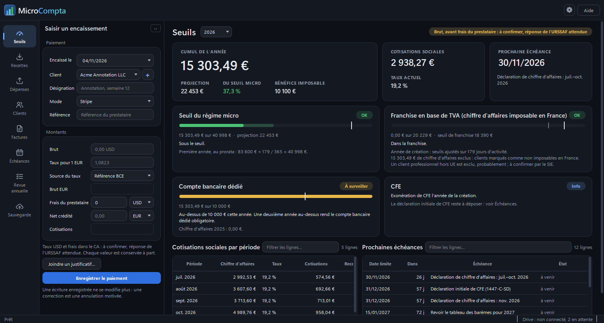

# MicroCompta

*In English: a desktop bookkeeping app for French micro-entrepreneurs. The app has an English
option, but this documentation is in French because the rules it follows are French.*

Un micro-entrepreneur doit tenir le livre des recettes, c'est-à-dire la liste datée de tout ce
qu'il encaisse. Il émet des factures, surveille plusieurs seuils de chiffre
d'affaires et déclare à l'URSSAF, l'organisme qui collecte ses cotisations sociales, tous les mois
ou tous les trimestres. MicroCompta tient ces registres sur votre ordinateur, sans abonnement. Il
calcule les cotisations à prévoir, vous rappelle les échéances et range une copie de chaque
document dans votre propre Google Drive.

L'application vise une activité libérale non réglementée, déclarée en bénéfices non commerciaux
(BNC), ou une activité de prestation de services déclarée en bénéfices industriels et commerciaux
(BIC). La vente de marchandises n'est pas prise en charge.



## Un exemple

Le 30 octobre 2026, un client américain vous paie 1 020 $ par Stripe. Stripe garde 29,88 $ de
frais et vous recevez 910,26 € sur votre compte. Dans le volet « Saisir un encaissement », vous
indiquez la date, le client, le montant brut, les frais et le net crédité. Vous ajoutez le taux
de change du jour publié par la Banque centrale européenne : 1,0823 $ pour 1 €.

L'application calcule alors le brut en euros, 942,44 €, et les cotisations de ce paiement :
180,95 €, au taux de 19,2 % qui s'appliquait ce jour-là à une activité libérale aidée par l'ACRE.
L'ACRE est une réduction de cotisations accordée aux créateurs d'entreprise pendant leurs
premiers trimestres. Le paiement s'ajoute au livre des recettes, au cumul de l'année et aux
seuils, puis la sauvegarde part vers Drive.

Une écriture enregistrée ne se modifie plus. Une erreur se corrige par une écriture d'annulation
motivée, comme le veut un registre comptable.

## Ce que fait l'application

- **Livre des recettes**, page Recettes : une écriture par encaissement, avec ses totaux
  trimestriels et ses exports CSV et PDF.
- **Registre des achats**, page Dépenses : vos dépenses professionnelles et leurs justificatifs.
  Il est obligatoire pour une activité libérale en franchise en base de TVA, c'est-à-dire quand
  vous ne facturez pas la TVA.
- **Factures** : une facture récapitule les paiements déjà reçus d'un mois. L'application en
  prépare le brouillon, puis émet la facture définitive au numéro suivant, en PDF. Une facture
  émise se corrige par une facture d'avoir.
- **Seuils** : votre chiffre d'affaires face au seuil du régime micro, aux seuils de la franchise
  en base de TVA et au seuil du compte bancaire dédié, avec une projection sur l'année.
- **Échéances** : les déclarations et autres dates calculées depuis votre date de début
  d'activité, avec des rappels dans la zone de notification de Windows.
- **Revue annuelle** : les totaux de l'année, le montant à reporter sur votre déclaration de
  revenus et une liste de contrôle.
- **Sauvegarde** : chaque document part dans votre Google Drive. Il ne compte comme envoyé que si
  Drive renvoie la même empreinte, un résumé calculé à partir du contenu, que le fichier local.

Chaque nombre, bouton et champ porte une bulle d'aide au survol de la souris. Les termes suivent
la rédaction des textes officiels ; le [glossaire](docs/glossaire.md) donne chacun avec sa source.

## Ce qu'elle ne fait pas

- Elle ne donne pas de conseil fiscal. Elle additionne et rappelle, et vous restez responsable de
  vos déclarations.
- Elle ne déclare rien à l'URSSAF ni aux impôts : vous le faites sur leurs sites.
- Elle ne gère pas la facturation électronique de la réforme en cours. Depuis le
  1er septembre 2026, toute entreprise, micro-entreprise comprise, doit pouvoir recevoir des
  factures électroniques par une plateforme agréée, un prestataire immatriculé par
  l'administration. Les micro-entreprises devront aussi en émettre à partir du
  1er septembre 2027. Les détails sont sur
  [economie.gouv.fr](https://www.economie.gouv.fr/tout-savoir-sur-la-facturation-electronique-pour-les-entreprises).
- Elle ne se connecte qu'à Google Drive. Le code qui parle à Drive n'a aucune commande de
  suppression, et des tests vérifient qu'il refuse toute autre adresse que celles de Google.

## Installer

Il faut Windows et Python 3.11 ou plus récent ; l'application a été utilisée avec Python 3.13.
Téléchargez le projet depuis cette page GitHub, avec le bouton « Code » puis « Download ZIP », et
double-cliquez sur `run.bat`. Le premier lancement installe ce dont l'application a besoin,
environ 770 Mo, crée les raccourcis et ouvre l'application.

Le pas à pas est dans [docs/installation.md](docs/installation.md), et le détail des raccourcis
Windows dans [docs/raccourci-windows.md](docs/raccourci-windows.md).

## Documentation

| Document | Pour qui | Ce que vous y trouvez |
| --- | --- | --- |
| [Installation](docs/installation.md) | Vous, sur Windows, sans connaissance technique | Installer, mettre à jour, déplacer, désinstaller |
| [Raccourcis Windows](docs/raccourci-windows.md) | Vous, après l'installation | Créer, recréer ou supprimer les raccourcis, lancer avec Windows |
| [Guide d'utilisation](docs/guide.md) | Vous, au quotidien | Chaque page de l'application et comment corriger une erreur |
| [Sauvegarde Google Drive](docs/sauvegarde-drive.md) | Vous, une fois, pour brancher Drive | Créer votre accès Google, ce qui est envoyé et où, restaurer |
| [Glossaire](docs/glossaire.md) | Vous, quand un terme vous arrête | Chaque terme officiel employé par l'application, avec sa source |
| [Confidentialité](docs/confidentialite.md) | Vous, et Google pour l'accès à Drive | Les données que l'application utilise, où elles vont, comment retirer l'accès |

Pour signaler un problème ou poser une question, ouvrez une « issue » sur cette page GitHub,
onglet « Issues ».

## Vos données

Vos registres, vos documents et votre accès Google sont rangés dans
`%LOCALAPPDATA%\MicroCompta`, hors du dossier de l'application. Ils ne peuvent donc pas se
retrouver dans ce projet, et une mise à jour de l'application ne les touche pas.

## Développement

Le code et les tests sont en anglais. Les règles et les registres sont dans `microcompta/core`,
sans interface. L'envoi vers Drive est dans `microcompta/backup`, et les écrans dans
`microcompta/ui`. Tous les montants, taux et seuils sont des données datées et modifiables dans
`microcompta/data/figures_seed.json`, jamais dans le code.

Pour lancer les tests, depuis le dossier du projet :

```bash
.venv\Scripts\python.exe -m pip install -r requirements-dev.txt
```

```bash
.venv\Scripts\python.exe -m pytest tests
```

Les tests utilisent un dossier temporaire et des données fictives, jamais vos registres. La
variable d'environnement `MICROCOMPTA_DATA_DIR` permet de choisir ce dossier.
`scripts\ui_smoke.py` construit la vraie fenêtre hors écran et enregistre des captures dans
`screenshots\`.

## Licence

GNU GPL v3 : voir le fichier [LICENSE](LICENSE).

## Prochaines étapes

- Tester Google Drive avec un vrai compte. La connexion et l'envoi n'ont été essayés que contre
  un faux Drive dans les tests.
- Ajouter à la page Échéances l'obligation de recevoir les factures électroniques, en vigueur
  depuis le 1er septembre 2026. La page ne cite aujourd'hui que l'échéance de 2027.
- Essayer `run.sh` sur macOS ou Linux. Le script existe, mais personne ne l'a encore lancé.
- Obtenir les réponses de l'URSSAF et du service des impôts aux questions encore ouvertes. Elles
  sont listées dans l'application, page Revue annuelle, et dans le
  [guide](docs/guide.md#ce-qui-reste-à-confirmer).
